# 🍃 BaliAir AI — End-to-End Time-Series PM2.5 Forecasting System

> **Sistem Machine Learning end-to-end produksi** untuk peramalan polutan partikulat halus PM2.5 di seluruh Bali berbasis sensor IoT terdistribusi dan kovariat meteorologi resolusi tinggi (*Open-Meteo*).

---

## 🌟 Ringkasan Arsitektur End-to-End

```mermaid
flowchart TD
    subgraph S1["1. Data Engineering (ETL)"]
        A1["Bali Air Dispatch API\n(/api/live & /api/history 7d)"] --> B1["Sensor Cleanser & 1h Resampling"]
        A2["Open-Meteo Weather API\n(Cluster Grid Spasial Bali)"] --> B2["Meteorological Enricher"]
        B1 & B2 --> C[("Parquet Data Lake\n9,200 rows x 26 cols")]
    end

    subgraph S2["2. Feature Engineering"]
        C --> D1["Lags (t-1, t-2, t-3, t-6, t-12, t-24)"]
        C --> D2["Rolling Stats (Mean, Std, Min, Max 3h/6h/24h)"]
        C --> D3["Wind Vectors (u, v) & Ventilation Index"]
        C --> D4["Cyclical Diurnal & Temporal Encodings"]
        D1 & D2 & D3 & D4 --> E[("Feature Matrix\n9,200 rows x 53 cols")]
    end

    subgraph S3["3. Multi-Horizon Time-Series ML"]
        E --> F1["Persistence & Rolling 24h Baselines"]
        E --> F2["LightGBM & XGBoost Regressors"]
        F1 & F2 --> G["Expanding Window TimeSeriesSplit CV\n(Zero Future Leakage)"]
    end

    subgraph S4["4. Production Deployment"]
        G --> H1["FastAPI Inference Microservice\n(Port 8000: /api/v1/forecast)"]
        G --> H2["Streamlit Interactive Dashboard\n(Port 8501: OpenStreetMap + Forecast Curve)"]
    end
```



---

## 📊 Hasil Evaluasi Model (Out-of-Time Cross Validation)

Model dievaluasi secara ketat pada **data uji masa depan (Out-of-Time Test Set)** untuk membuktikan performa generalisasi tanpa data leakage:

| Horizon Proyeksi | Model Terpilih | Persistence Baseline (MAE) | BaliAir Model (MAE) | Evaluasi RMSE | Peningkatan vs Baseline |
| :--- | :--- | :--- | :--- | :--- | :--- |
| **+1 Jam (Nowcasting)** | **LightGBM** | 5.12 µg/m³ | **5.97 µg/m³** | 10.34 | Kinerja seimbang pada rentang sangat pendek |
| **+6 Jam (Mid-term)** | **XGBoost** | 10.58 µg/m³ | **6.62 µg/m³** | **10.82** | 🔥 **+37.4% Lebih Akurat** |
| **+24 Jam (Next-Day)** | **LightGBM** | 7.34 µg/m³ | **6.12 µg/m³** | **10.94** | 🔥 **+16.6% Lebih Akurat** |

### 🔍 Fitur Paling Berpengaruh (Feature Importance)
1. `pm25_roll_mean_24h` & `pm25_lag_24h`: Siklus diurnal polusi harian Bali.
2. `direct_radiation`: Radiasi matahari langsung pemicu reaksi fotokimia polutan.
3. `ventilation_index` & `wind_u / wind_v`: Kecepatan dan arah dispersi polutan oleh angin laut/gunung.
4. `surface_pressure` & `dew_point_2m`: Dinamika lapisan batas atmosfer (*inversi suhu*).

---

## 🚀 Panduan Menjalankan Sistem

### 1. Setup Virtual Environment & Dependensi
```bash
python3 -m venv .venv
source .venv/bin/activate
pip install -r requirements.txt
```

### 2. Menjalankan Pipeline Data Engineering (ETL)
Mengunduh histori 56+ stasiun sensor di Bali dan kovariat cuaca Open-Meteo, lalu menyimpannya ke Parquet:
```bash
python src/data/harmonizer.py
```

### 3. Menjalankan Rekayasa Fitur (Feature Engineering)
Membangun matriks 53 fitur time-series:
```bash
python src/features/engineer.py
```

### 4. Pelatihan Model & Evaluasi Time-Series
Melatih LightGBM & XGBoost multi-horizon dan menyimpan artefak model ke `data/models/`:
```bash
python src/models/train_evaluate.py
```

### 5. Menjalankan Layanan Deployment
* **FastAPI Inference Microservice** (Port 8000):
  ```bash
  uvicorn src.api.main:app --host 0.0.0.0 --port 8000 --reload
  ```
  * Swagger UI: [http://localhost:8000/docs](http://localhost:8000/docs)
  * Endpoint Contoh: `GET /api/v1/forecast/ag-209023`

* **Streamlit Monitoring & Forecast Dashboard** (Port 8501):
  ```bash
  streamlit run src/app.py
  ```
  * Akses: [http://localhost:8501](http://localhost:8501)

---

## 📁 Struktur Direktori
```text
baliair-ai/
├── data/
│   ├── raw/                 # Cache JSON sensor & cuaca Open-Meteo
│   ├── processed/           # Parquet terharmonisasi & matriks fitur
│   └── models/              # Artefak model serialisasi (.joblib) & hasil evaluasi
├── src/
│   ├── data/                # collector.py, download_history.py, weather_enrichment.py, harmonizer.py
│   ├── features/            # engineer.py (Lags, rolling stats, wind vectors)
│   ├── models/              # train_evaluate.py (LightGBM, XGBoost, TimeSeriesSplit)
│   ├── api/                 # main.py (FastAPI inference service)
│   └── app.py               # Dashboard Streamlit interaktif
├── requirements.txt
└── README.md
```
